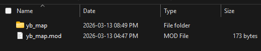

## Changes

### In-Game

- Maintained compatibility with Crusader Kings III 1.18 "Crane".
- No gameplay or visual changes.

### Development

- Added DDS texture assets to the repository and configured Git LFS for the original flatmap.
- Updated Git attributes and ignore rules.
- Standardized file encoding and formatting.
- Cleaned up mod descriptor metadata.

## Manual Installation

1. Download the `yb_map-1.2.1.zip` file from the assets section.
2. Extract the contents to `%USERPROFILE%\Documents\Paradox Interactive\Crusader Kings III\mod\`

The mod folder should look something like this:

> [!NOTE]
> When reinstalling, remove the previous `yb_map` folder before extracting the new version to avoid leaving obsolete files behind.