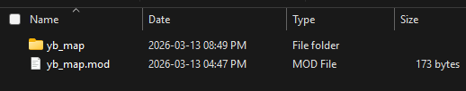

## Changes

### In-Game

- Updated compatibility with Crusader Kings III 1.19 "Scribe".

### Development

- Added README and Steam Workshop descriptions, including installation instructions and updated screenshots.
- Refined Git LFS configuration and repository ignore rules.

## Manual Installation

1. Download the `yb_map-1.2.2.zip` file from the assets section.
2. Extract the contents to `%USERPROFILE%\Documents\Paradox Interactive\Crusader Kings III\mod\`

The mod folder should look something like this:

> [!NOTE]
> When reinstalling, remove the previous `yb_map` folder before extracting the new version to avoid leaving obsolete files behind.

**Full Changelog:** https://github.com/Yusseter/Yusseters-Better-Map-Graphics/compare/v1.2.1...v1.2.2
