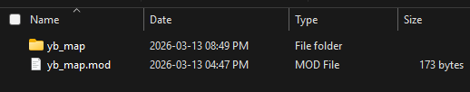

## Changes

### In-Game

- Updated compatibility with Crusader Kings III 1.21 "Florin".
- Updated the wavy noise texture to prevent black terrain rendering in CK3 1.21 (#1).
- Added support for the new Sign-up Bonus paper map style.
- Refined map name rendering, zoom transitions, and shadow appearance.

### Development

- Updated compatibility information in the README and distribution descriptions.

## Manual Installation

1. Download the `yb_map-1.2.4.zip` file from the assets section.
2. Extract the contents to `%USERPROFILE%\Documents\Paradox Interactive\Crusader Kings III\mod\`.

The mod folder should look something like this:

> [!NOTE]
> When reinstalling, remove the previous `yb_map` folder before extracting the new version to avoid leaving obsolete files behind.

**Full Changelog:** https://github.com/Yusseter/Yusseters-Better-Map-Graphics/compare/v1.2.3...v1.2.4
